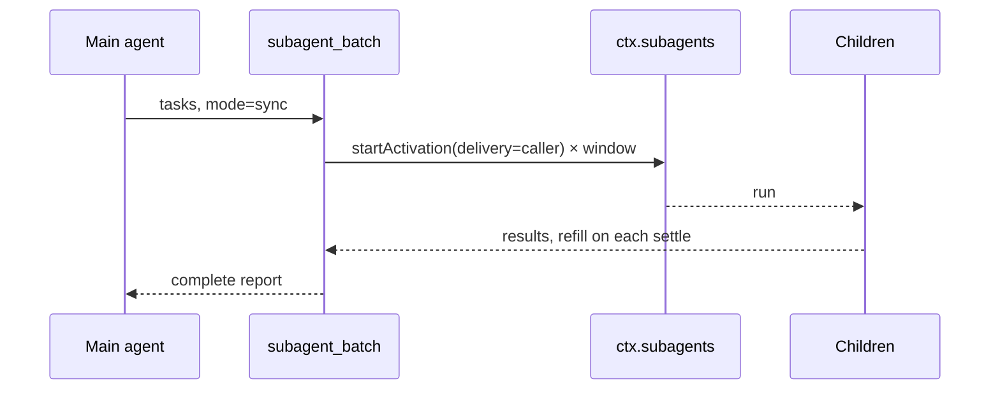
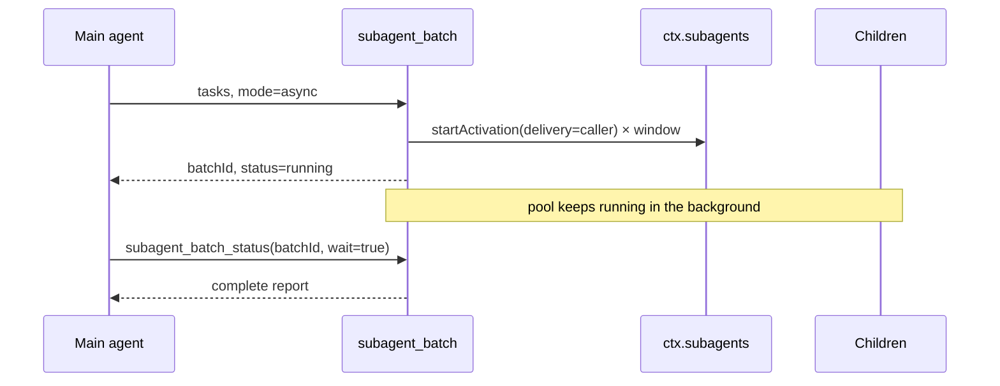

# dsh-tool-subagent-batch

[](LICENSE)
[](https://nodejs.org)
[](package.json)

**English** | [简体中文](README.zh.md)

A rolling-window batch scheduler for [DeepSeek Harness](https://github.com/deepseek-ai/deepseek-harness) subagents, with **synchronous and asynchronous** parallel modes.

One tool call carries a queue of independent subtasks and a concurrency window. The plugin starts up to *N* fresh children, and **the moment any child settles, the next queued task takes its slot**.

- **Sync mode** — the call blocks until every task settles, then returns the complete report for acceptance.
- **Async mode** — the call returns a batch id immediately; the pool keeps running in the background and is collected later with `subagent_batch_status`.

```
tasks:   [1] [2] [3] [4] [5] [6]
window:  [1] [2] [3]          ← all start together
             ↓ 1 finishes
window:      [2] [3] [4]      ← 4 backfills immediately
```

This diagram describes the **shared rolling-window scheduler** used by both modes. The mode changes only how the result is delivered: `sync` returns it as the tool result, `async` returns a batch id and delivers it through `subagent_batch_status`.

## Why

DSH already has a `subagent` tool, but it returns as soon as a child is admitted. When you fire many calls at once:

- the Host's `maxActiveSubagents` admission cap (default **8**) rejects the overflow instead of queueing it;
- the parent has no single place to collect and compare results;
- a failed child can be lost among unrelated completion notices.

This plugin turns that into a **bounded, self-refilling pool** with one aggregated report. Sync mode suits "do this batch now and give me the results"; async mode suits "start this batch and let me keep working".

## Features

- **Two modes, one scheduler** — `sync` blocks for the report; `async` returns immediately and runs in the background.
- **Rolling window, not fixed chunks** — a slot is refilled as soon as any child settles, not after the whole batch.
- **User-owned concurrency** — explicit config, environment variable, or a hardware-based recommendation. The model cannot change it unless you opt in.
- **Hardware-aware recommendation** — reads logical cores, total RAM, free RAM, and the Host admission cap.
- **Async status tool** — poll progress, block with a timeout, or cancel a running batch.
- **Per-task acceptance report** — status, final answer, stop reason, duration, and child id for every task.
- **Failure isolation** — one failed child does not consume the queue; optional `fail_fast`.
- **Cooperative cancellation** — sync cancellation stops admissions and disposes running children; async cancellation does the same through the status tool.
- **Capacity backoff** — a host admission refusal is retried (30 × 500 ms) before a task is failed.
- **Depth guard** — respects the Host `subagent.maxDepth` policy and the calling agent's current depth.
- **Output clipping** — keeps one huge answer from flooding the parent context.
- **Zero runtime dependencies** — Node builtins only, so it can be mounted as a single file.

## Modes

| | `sync` | `async` |
|---|---|---|
| Returns | after every task settles | immediately, with a batch id |
| Parent turn | blocked for the whole batch | free to continue or end |
| Collection | the tool result itself | `subagent_batch_status` |
| Progress | none until done | snapshots per call |
| Cancellation | abort the tool call | `cancel: true` on the status tool |
| Best for | "run this batch now" | long batches, or parallel work alongside other tasks |

The configured default is `mode: sync`; pass `"mode": "async"` per call, or set `mode: async` in the profile to make async the default.

### Async lifecycle

1. `subagent_batch` validates the tasks, provider, depth, and concurrency, starts the scheduler, and returns a **running snapshot** with a `batchId`.
2. The pool continues in the same DSH process after the tool call returns.
3. The main agent collects it with `subagent_batch_status`:
   - `{ "batchId": "..." }` — immediate progress snapshot;
   - `{ "batchId": "...", "wait": true, "timeout_ms": 120000 }` — block until it settles or the timeout expires;
   - `{ "batchId": "...", "cancel": true }` — stop every running child and skip the queue.
4. Finished batches stay readable for recent status calls, up to `retainedBatches`.

Async mode does **not** push a completion message into the parent session. The main agent polls or waits with the status tool. This is deliberate: it keeps the parent transcript free of *N* completion notices and lets the caller decide when to collect.

## How it works

Sync mode:



Async mode:



The core is a small scheduler shared by both modes:

```js
while (cursor < tasks.length || running.size > 0) {
  while (running.size < concurrency && cursor < tasks.length) {
    running.set(cursor, runOne(cursor++))
  }
  await Promise.race(running.values())   // wake on ANY settle
}
```

Each `runOne` calls `ctx.subagents.startActivation({ delivery: 'caller', ... })`, awaits `activation.result`, maps the stop reason, and disposes the activation in `finally`.

`delivery: 'caller'` is deliberate: the subagent runtime does **not** inject a completion notice into the parent session. The batch owns collection, so the caller receives one deterministic report instead of *N* interleaved messages.

## Requirements

| Requirement | Notes |
|---|---|
| DSH `0.2.x` | Uses `ctx.subagents.startActivation`, `resolveMaxDepth`, and `ctx.tools.register` |
| A subagent provider | `spawn` is the default backend; it ships with `@deepseek-ai/dsh-subagent-spawn-in-process` |
| Node.js 20+ | DSH bundles a compatible Node; nothing to install |
| Runtime dependencies | none |

## Installation

Pick one option. Both end with `subagent_batch` and `subagent_batch_status` visible to the model.

### Option 1 — bundle package (recommended)

Use this when you want the plugin managed like any other DSH bundle.

```sh
git clone https://github.com/<you>/dsh-tool-subagent-batch.git
cd dsh-tool-subagent-batch
dsh plugin --profile desktop add "link:$PWD"
```

On Windows PowerShell:

```powershell
dsh plugin --profile desktop add "link:E:\path\to\dsh-tool-subagent-batch"
```

Then select the bundle in the profile's `package.json`:

```json
{
  "dsh": {
    "profile": {
      "bundles": [
        "@deepseek-ai/dsh-base",
        "@deepseek-ai/dsh-web-app",
        "dsh-tool-subagent-batch"
      ]
    }
  }
}
```

or enable it on the **Plugins** page, then reload/restart the profile. The package declares its own bundle patch in [`cordis.patch.yml`](cordis.patch.yml).

### Option 2 — zero-install file mount

Use this to try the plugin without touching `node_modules`. Add a row to `$DSH_HOME/profiles/<profile>/cordis.patch.yml`:

```yaml
- insert:
    - id: tool-subagent-batch
      name: 'E:/path/to/dsh-tool-subagent-batch/index.js'
      config:
        concurrency: auto
        mode: sync
```

- Quote the path. Forward slashes work on Windows.
- The loader resolves an absolute row name to a `file:` URL, so no package installation is required.
- A running profile with HMR reloads the patch; otherwise restart DSH.

## Configuration

| Field | Default | Meaning |
|---|---|---|
| `provider` | `spawn` | Subagent provider name on `ctx.subagents`. |
| `toolName` | `subagent_batch` | Model-facing batch tool name. |
| `statusToolName` | `subagent_batch_status` | Model-facing status tool for async batches. |
| `mode` | `sync` | Default mode: `sync` or `async`. |
| `concurrency` | `auto` | User-owned window: an integer `1..maxConcurrency`, or `auto`. |
| `maxConcurrency` | `8` | Ceiling for `auto`, the environment, and (when enabled) the model. |
| `allowModelConcurrency` | `false` | `false` hides the model parameter; `"lower"` lets the model only shrink the window; `true` lets it choose up to `maxConcurrency`. |
| `maxTasks` | `32` | Largest queue one call may carry. |
| `outputCharsPerTask` | `12000` | Characters of each child answer retained in the report. |
| `maxAsyncBatches` | `8` | Concurrent async batches allowed per parent session. |
| `retainedBatches` | `16` | Finished batches kept for later status reads. |
| `maxDepth` | Host setting | Absolute delegation-depth cap; omit to use `subagent.maxDepth` (default `1`). |

Unknown fields are rejected at mount, so a typo fails loudly instead of being silently ignored.

## Concurrency is yours

Resolution order at mount time:

| Order | Source | When |
|---|---|---|
| 1 | `config.concurrency: <n>` | Always wins. |
| 2 | `DSH_SUBAGENT_BATCH_CONCURRENCY=<n\|auto>` | Used only while `config.concurrency` is `auto`. |
| 3 | Hardware recommendation | The fallback for `auto`. |
| 4 | Model request | Only when `allowModelConcurrency` is `"lower"` or `true`. |

### Get a recommendation

```sh
node bin/recommend.mjs
# or
npx dsh-subagent-batch-recommend --json
```

Example on a 16-core, 24 GiB machine:

```text
Recommended concurrency: 6
Machine: 16 logical cores, 23.2 GiB RAM (8.9 GiB free)
Why: 16 logical cores, 23.2 GiB RAM (8.9 GiB free): CPU budget 6,
memory budget 8, free-memory headroom 8, cap 8 → 6

Set it in your profile's cordis.patch.yml:

  - id: tool-subagent-batch
    config:
      concurrency: 6
```

The heuristic treats subagents as mostly I/O-bound: roughly one child per two hardware threads (2–6), bounded by memory (`(total RAM − 1 GiB) / 1.5 GiB`), reduced to 1–2 when free memory is tight, and capped by `maxConcurrency` and the Host's `maxActiveSubagents`.

### Change it later

```yaml
# 1. Fixed by the user — the model cannot override it
- id: tool-subagent-batch
  config:
    concurrency: 4

# 2. Let the model run a smaller batch, never a larger one
- id: tool-subagent-batch
  config:
    concurrency: 4
    allowModelConcurrency: lower

# 3. Let the model choose within your ceiling
- id: tool-subagent-batch
  config:
    maxConcurrency: 8
    allowModelConcurrency: true
```

Environment override (PowerShell / bash):

```powershell
$env:DSH_SUBAGENT_BATCH_CONCURRENCY = "4"
```

```sh
export DSH_SUBAGENT_BATCH_CONCURRENCY=4
```

## Usage

### Sync mode

Ask the main agent for a batch, for example:

> I have six independent modules to review. Use `subagent_batch` in sync mode, at most three at a time, and report each result.

```json
{
  "tasks": [
    { "description": "Review auth module", "prompt": "Review src/auth for ... Report findings only." },
    { "description": "Review billing module", "prompt": "Review src/billing for ..." },
    { "description": "Review search module", "prompt": "Review src/search for ..." }
  ],
  "mode": "sync",
  "fail_fast": false
}
```

With `concurrency: 3` the three children start immediately. With `concurrency: 2`, the third starts as soon as either of the first two settles. The call returns the complete report.

### Async mode

> Start the same six reviews in async mode, then let me know when they are done.

The model starts the batch:

```json
{
  "tasks": [
    { "description": "Review auth module", "prompt": "Review src/auth for ..." },
    { "description": "Review billing module", "prompt": "Review src/billing for ..." }
  ],
  "mode": "async"
}
```

The immediate result is a running snapshot:

```json
{
  "batchId": "batch-1f0c...",
  "mode": "async",
  "status": "running",
  "total": 2,
  "completed": 0,
  "failed": 0,
  "cancelled": 0,
  "skipped": 0,
  "pending": 1,
  "running": 1,
  "concurrency": 3,
  "concurrencySource": "config",
  "startedAt": "2026-10-30T09:41:00.000Z",
  "durationMs": 12,
  "results": [
    { "index": 1, "description": "Review auth module", "status": "running", "childId": "session-...", "output": "", "outputTruncated": false, "durationMs": 12 },
    { "index": 2, "description": "Review billing module", "status": "pending", "output": "", "outputTruncated": false, "durationMs": 0 }
  ]
}
```

Later, collect it:

```json
{
  "batchId": "batch-1f0c...",
  "wait": true,
  "timeout_ms": 120000
}
```

`subagent_batch_status` accepts:

| Field | Meaning |
|---|---|
| `batchId` | Required. The id returned by the async start. |
| `wait` | Wait until the batch settles or the timeout expires. |
| `timeout_ms` | Wait bound, `1000..600000`, default `60000`. |
| `cancel` | Cancel the batch and wait for its children to stop. |

Only the session that started the batch can read or cancel it. Without `wait`, the call returns a snapshot immediately; poll it to show progress.

### Result

```json
{
  "batchId": "batch-1f0c...",
  "mode": "sync",
  "status": "completed",
  "total": 3,
  "completed": 2,
  "failed": 1,
  "cancelled": 0,
  "skipped": 0,
  "pending": 0,
  "running": 0,
  "concurrency": 3,
  "concurrencySource": "config",
  "startedAt": "2026-10-30T09:41:00.000Z",
  "finishedAt": "2026-10-30T09:41:48.000Z",
  "durationMs": 48210,
  "results": [
    {
      "index": 1,
      "description": "Review auth module",
      "status": "completed",
      "childId": "session-...",
      "stopReason": "completed",
      "output": "Found two issues: ...",
      "outputTruncated": false,
      "durationMs": 22100
    },
    {
      "index": 2,
      "description": "Review billing module",
      "status": "failed",
      "childId": "session-...",
      "stopReason": "error",
      "output": "",
      "outputTruncated": false,
      "durationMs": 900,
      "error": "child stopped with reason \"error\"",
      "diagnostic": "..."
    }
  ]
}
```

`childId` is a durable session id. In deployments that mount `@deepseek-ai/dsh-tool-subagent-control`, the main agent can use `send_message` to continue a child, for example to ask for a corrected answer, without rerunning the whole batch.

### Statuses

Batch status:

| Status | Meaning |
|---|---|
| `running` | The pool has not settled; some tasks may be pending or running. |
| `completed` | Every task settled (individually completed, failed, or skipped). |
| `cancelled` | The batch was cancelled before every task settled. |

Task status:

| Status | Meaning |
|---|---|
| `pending` | Queued, not admitted yet. |
| `running` | A child is executing this task. |
| `completed` | Child stopped with `stopReason: "completed"`. |
| `failed` | Start rejection, child error, or non-completed stop reason. |
| `cancelled` | Child stopped because the batch was cancelled. |
| `skipped` | Never started, because `fail_fast` fired or the batch was cancelled. |

## Semantics and guarantees

- **Submission order** — tasks are admitted from index 0 upward; results are always in submission order.
- **Refill on any settle** — success and failure both free a slot.
- **Bounded queue** — at most `concurrency` children are live at once; the rest wait in-process.
- **Failure isolation** — a failed task never stops the queue unless `fail_fast: true`; running children still finish.
- **Sync cancellation** — the tool observes `exec.signal`; on abort it disposes every running activation, stops admitting, waits for cleanup, then lets the call settle as `ABORTED`.
- **Async cancellation** — the status tool aborts the batch, disposes running activations, and returns a `cancelled` report.
- **Async ownership** — only the exact owning session can inspect or cancel a batch.
- **Async retention** — finished batches stay in process memory for `retainedBatches` entries; older finished batches are evicted. Running batches are never evicted.
- **Parent disposal** — disposing the parent session cancels its running async batches; plugin unload cancels every batch.
- **Capacity backoff** — `ACTIVATION_LIMIT_REACHED` is retried every 500 ms up to 30 times, then fails only that task.
- **Depth** — a child at the depth cap is rejected with an actionable error instead of silently starting a doomed descendant.
- **No completion notices** — with `delivery: 'caller'` the parent receives one report, not one message per child.
- **Disposal** — every admitted activation is disposed exactly once, including on failure and cancellation.

## Security and permissions

- Installing a profile plugin runs **Host code in-process**, outside the workspace file sandbox. Review the source before enabling it.
- Batch children inherit the calling agent's fixed delegated permission scope. They cannot widen it or obtain new approvals; an operation that would require approval inside a child is rejected.
- The plugin adds no network, filesystem, or process access of its own.
- Task prompts are sent to the configured model provider as child conversations; do not put secrets in prompts that the provider should not see.
- Async batches keep running after the start call returns. Cancel them explicitly when they are no longer wanted, or dispose the parent session.

## Compatibility

- Built against DSH `0.2.1-rc.5` and the public `0.2.x` plugin seams. The scheduler and both modes are unit-tested with a fake `ctx.subagents`; run one real batch in your deployment before relying on it.
- Optional integration: reads `ctx.subagents.config.maxActiveSubagents` when present and falls back gracefully when it is not.
- The tool schemas use plain JSON Schema from the DSH-supported subset (`type`, `properties`, `required`, `additionalProperties`, `items`, `enum`, `description`).
- No peer package is imported at runtime; the plugin is a single ESM file.

## Troubleshooting

| Symptom | Cause / fix |
|---|---|
| `subagent_batch` is not visible | The row is disabled, the profile did not reload, or `tools`/`subagents` are not mounted. Check the Loader log and restart. |
| `subagent_batch_status` is not visible | It is registered next to the batch tool. Check tool restrictions for the session; both use the same plugin row. |
| `subagent provider "spawn" is not registered` | Mount `@deepseek-ai/dsh-subagent-spawn-in-process`, or set `provider` to a registered backend. |
| `concurrency is user-controlled` | The model passed `concurrency` while `allowModelConcurrency` is `false`. That is the intended policy; enable `"lower"` or `true` to allow it. |
| `ACTIVATION_LIMIT_REACHED` after retries | Other children occupy the Host admission tree. Lower `concurrency` or raise `subagent.maxActiveSubagents`. |
| `cannot delegate from depth ...` | The caller already sits at `subagent.maxDepth` (default 1). Do the work in the child directly or raise the limit. |
| `unknown or expired batch` | The id is wrong, the process restarted, or the batch was evicted by `retainedBatches`. Finished batches are process-local. |
| `batch ... belongs to another session` | Only the session that started an async batch can inspect or cancel it. |
| `already has N running asynchronous batches` | Raise `maxAsyncBatches`, or wait for one to settle. |
| Async batch finished but no message arrived | Async mode does not push notifications by design. Call `subagent_batch_status` with `wait: true`. |
| Recommendation feels too high | Set an explicit `concurrency`. The heuristic is a starting point, not a promise about API rate limits. |
| `npm test` fails with `spawn EPERM` in a restricted sandbox | The Node test runner spawns workers. Run `npm run test:unit`, which executes the test files in-process. |

## Limitations

- **Sync mode is blocking**: the parent turn waits until every task settles; child progress is not streamed.
- **Async mode has no push notification**: the parent must poll or wait with `subagent_batch_status`. Progress is per task, not per token.
- **Async state is process-local**: a DSH restart loses batch ids and reports. Running children are cancelled on parent disposal or plugin unload.
- One call is one batch. A second batch starts a new window; the plugin does not merge queues.
- Failed tasks are not retried automatically — the main agent decides whether to rerun or continue a child.
- A child's final message is clipped at `outputCharsPerTask`; the full transcript remains in the child session.
- Children run in-process under the parent's runtime. This is not a sandbox boundary.
- Concurrency is resolved when the plugin mounts; changing config/env requires a profile reload.

## Development

```sh
npm test          # node --test, discovers test/*.test.js
npm run test:unit # executes the test files in-process (works in restricted sandboxes)
npm run recommend # hardware recommendation
```

No install step is required: the package has no dependencies.

```
.
├── index.js                 # plugin + scheduler + recommendation (single file)
├── bin/recommend.mjs        # standalone recommendation CLI
├── cordis.patch.yml         # bundle patch used when installed as a package
├── examples/cordis.patch.yml# zero-install mounting examples
├── test/                    # node:test suites
├── README.md                # English
└── README.zh.md             # 简体中文
```

Contributions are welcome. Keep the plugin dependency-free and add a test for every behavior change.

## License

[MIT](LICENSE)
