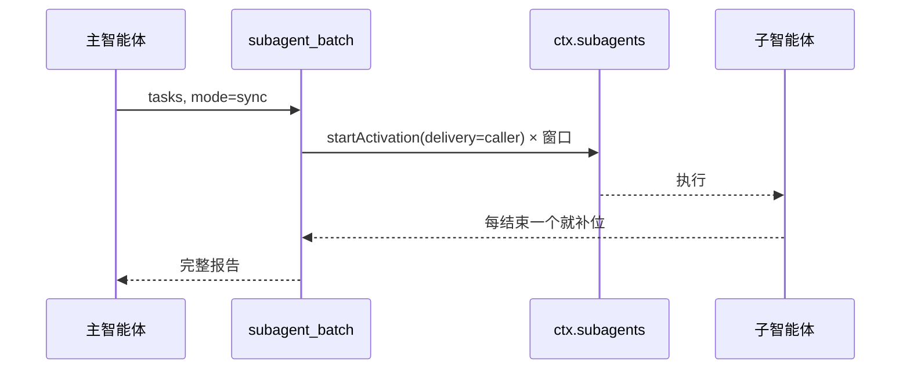
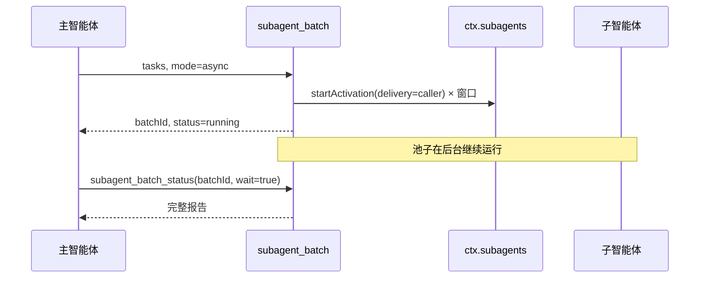

# dsh-tool-subagent-batch

[](LICENSE)
[](https://nodejs.org)
[](package.json)

[English](README.md) | **简体中文**

面向 [DeepSeek Harness](https://github.com/deepseek-ai/deepseek-harness) 子智能体的滑动窗口批处理调度器，支持**同步并行**和**异步并行**两种模式。

一次工具调用携带一批独立子任务和一个并发窗口。插件最多同时启动 *N* 个子智能体，**任意一个子智能体一结束，队列里的下一个立刻补进空出的槽位**。

- **同步模式**：调用一直等到所有任务结束，然后返回完整报告供验收。
- **异步模式**：调用立即返回一个批次 id，池子在后台继续运行，之后用 `subagent_batch_status` 收取结果。

```
任务队列：[1] [2] [3] [4] [5] [6]
窗口：    [1] [2] [3]          ← 同时启动
              ↓ 1 结束
窗口：        [2] [3] [4]      ← 4 立即补位
```

这张图描述的是**两种模式共用的滑动窗口调度**。模式只改变结果的交付方式：`sync` 直接作为工具返回值返回，`async` 先返回批次 id，再通过 `subagent_batch_status` 收取。

## 为什么需要它

DSH 自带的 `subagent` 工具在子智能体被接纳后就立即返回。一次性并发很多个时会出现：

- 宿主的 `maxActiveSubagents` 接纳上限（默认 **8**）会直接拒绝超出的调用，而不是排队；
- 主智能体没有统一的地方收集、对比结果；
- 某个子智能体失败时，它的结果容易淹没在大量完成通知里。

这个插件把它变成一个**有界、可自动补位的池**，并给主智能体一份可验收的汇总报告。同步模式适合“现在就把这批活干完并给我结果”；异步模式适合“先把这批活跑起来，我继续做别的”。

## 功能

- **两种模式，一套调度器**：`sync` 阻塞等待报告；`async` 立即返回并在后台运行。
- **滑动窗口，而不是固定分批**：任意子智能体结束就补位，不必等整批结束。
- **并发数由用户决定**：支持显式配置、环境变量、本机硬件推荐三种来源；默认不允许模型改动。
- **读取本机配置推荐并发数**：根据逻辑核心数、总内存、空闲内存和宿主接纳上限计算建议值。
- **异步状态工具**：轮询进度、带超时阻塞等待、取消正在运行的批次。
- **逐任务验收报告**：状态、最终答复、停止原因、耗时、子会话 id 一目了然。
- **失败隔离**：单个任务失败不会卡住队列；可选 `fail_fast`。
- **协作式取消**：同步调用取消会停止接纳并销毁运行中的子智能体；异步批次通过状态工具取消。
- **容量退避**：遇到宿主接纳上限时按 30 次 × 500ms 重试，仍失败才把该任务记为失败。
- **深度保护**：遵守宿主 `subagent.maxDepth` 和当前调用者的委派深度。
- **输出裁剪**：避免一个超长答复撑爆主智能体上下文。
- **零运行时依赖**：只用 Node 内置模块，可作为单文件挂载。

## 两种模式

| | `sync` | `async` |
|---|---|---|
| 返回时机 | 所有任务结束后 | 立即返回批次 id |
| 父智能体这一轮 | 被整批占用 | 可以继续或结束 |
| 结果收取 | 工具返回值本身 | `subagent_batch_status` |
| 进度 | 结束前不可见 | 每次状态调用一个快照 |
| 取消方式 | 中止工具调用 | 状态工具 `cancel: true` |
| 适合场景 | “现在就跑完这批” | 长批次，或想同时做别的事 |

默认模式是 `mode: sync`；单次调用传 `"mode": "async"`，或在 profile 里设置 `mode: async` 把异步设为默认。

### 异步生命周期

1. `subagent_batch` 校验任务、provider、深度和并发数，启动调度器，立即返回一个**运行中快照**和 `batchId`。
2. 工具调用返回后，池子在同一个 DSH 进程里继续运行。
3. 主智能体用 `subagent_batch_status` 收取：
   - `{ "batchId": "..." }` —— 立即返回进度快照；
   - `{ "batchId": "...", "wait": true, "timeout_ms": 120000 }` —— 阻塞到批次结束或超时；
   - `{ "batchId": "...", "cancel": true }` —— 停止所有运行中的子智能体，未启动任务不再启动。
4. 已完成的批次会保留在进程内存里，供最近的若干次状态查询使用，数量由 `retainedBatches` 控制。

异步模式**不会**向父会话推送完成消息。主智能体需要主动轮询或等待。这是刻意设计：避免 *N* 条完成通知污染父会话，也让调用方自己决定何时收取。

## 工作原理

同步模式：



异步模式：



两种模式共用同一个调度循环：

```js
while (cursor < tasks.length || running.size > 0) {
  while (running.size < concurrency && cursor < tasks.length) {
    running.set(cursor, runOne(cursor++))
  }
  await Promise.race(running.values())   // 任意一个结束就唤醒
}
```

每个 `runOne` 调用 `ctx.subagents.startActivation({ delivery: 'caller', ... })`，等待 `activation.result`，映射停止原因，并在 `finally` 中 `dispose()`。

`delivery: 'caller'` 是刻意选择：子智能体运行时**不会**向父会话注入完成通知，收集工作完全由批处理自己负责。调用方因此只收到一份确定的汇总报告，而不是 *N* 条交错插入的消息。

## 环境要求

| 要求 | 说明 |
|---|---|
| DSH `0.2.x` | 使用 `ctx.subagents.startActivation`、`resolveMaxDepth`、`ctx.tools.register` |
| 子智能体 provider | 默认后端是 `spawn`，由 `@deepseek-ai/dsh-subagent-spawn-in-process` 提供 |
| Node.js 20+ | DSH 已自带兼容的 Node，无需单独安装 |
| 运行时依赖 | 无 |

## 安装

二选一，最终效果都是让模型看到 `subagent_batch` 和 `subagent_batch_status` 两个工具。

### 方式一：作为 bundle 包安装（推荐）

适合希望像普通 DSH 插件一样管理的场景。

```sh
git clone https://github.com/<you>/dsh-tool-subagent-batch.git
cd dsh-tool-subagent-batch
dsh plugin --profile desktop add "link:$PWD"
```

Windows PowerShell：

```powershell
dsh plugin --profile desktop add "link:E:\path\to\dsh-tool-subagent-batch"
```

然后在 profile 的 `package.json` 中选中该 bundle：

```json
{
  "dsh": {
    "profile": {
      "bundles": [
        "@deepseek-ai/dsh-base",
        "@deepseek-ai/dsh-web-app",
        "dsh-tool-subagent-batch"
      ]
    }
  }
}
```

也可以在 **Plugins** 页面启用它，然后重载/重启 profile。包内已声明自己的 bundle patch：[`cordis.patch.yml`](cordis.patch.yml)。

### 方式二：绝对路径零安装挂载

不想动 `node_modules` 时，直接在 `$DSH_HOME/profiles/<profile>/cordis.patch.yml` 添加：

```yaml
- insert:
    - id: tool-subagent-batch
      name: 'E:/path/to/dsh-tool-subagent-batch/index.js'
      config:
        concurrency: auto
        mode: sync
```

- 路径要加引号；Windows 下推荐使用正斜杠。
- Loader 会把绝对路径的 `name` 解析成 `file:` URL，因此不需要安装包。
- 启用 HMR 的 profile 会自动重载；否则重启 DSH。

## 配置

| 字段 | 默认值 | 含义 |
|---|---|---|
| `provider` | `spawn` | `ctx.subagents` 上的 provider 名称。 |
| `toolName` | `subagent_batch` | 模型看到的批处理工具名。 |
| `statusToolName` | `subagent_batch_status` | 模型看到的异步状态工具名。 |
| `mode` | `sync` | 默认模式：`sync` 或 `async`。 |
| `concurrency` | `auto` | 用户决定的窗口：`1..maxConcurrency` 的整数，或 `auto`。 |
| `maxConcurrency` | `8` | `auto`、环境变量以及（启用时）模型可选窗口的上限。 |
| `allowModelConcurrency` | `false` | `false` 不向模型暴露并发参数；`"lower"` 只允许模型调小；`true` 允许模型在 `maxConcurrency` 内选择。 |
| `maxTasks` | `32` | 单次调用最多携带的任务数。 |
| `outputCharsPerTask` | `12000` | 每个子任务答复在报告中保留的字符数。 |
| `maxAsyncBatches` | `8` | 每个父会话允许同时运行的异步批次数。 |
| `retainedBatches` | `16` | 已结束批次保留供状态查询的数量。 |
| `maxDepth` | 宿主设置 | 绝对委派深度上限；省略则使用 `subagent.maxDepth`（默认 `1`）。 |

未知字段会在挂载时报错，拼错配置不会静默失效。

## 并发数由用户决定

挂载时的解析顺序：

| 顺序 | 来源 | 何时生效 |
|---|---|---|
| 1 | `config.concurrency: <n>` | 始终优先。 |
| 2 | `DSH_SUBAGENT_BATCH_CONCURRENCY=<n\|auto>` | 仅当 `config.concurrency` 为 `auto`。 |
| 3 | 硬件推荐 | `auto` 的兜底。 |
| 4 | 模型请求 | 仅当 `allowModelConcurrency` 为 `"lower"` 或 `true`。 |

### 获取推荐值

```sh
node bin/recommend.mjs
# 或
npx dsh-subagent-batch-recommend --json
```

在一台 16 核、24 GiB 内存的机器上：

```text
Recommended concurrency: 6
Machine: 16 logical cores, 23.2 GiB RAM (8.9 GiB free)
Why: 16 logical cores, 23.2 GiB RAM (8.9 GiB free): CPU budget 6,
memory budget 8, free-memory headroom 8, cap 8 → 6

Set it in your profile's cordis.patch.yml:

  - id: tool-subagent-batch
    config:
      concurrency: 6
```

推荐规则把子智能体视为以 I/O 等待为主：大约每两个硬件线程一个子智能体（范围 2–6），再受内存预算（`(总内存 − 1 GiB) / 1.5 GiB`）约束；空闲内存紧张时降到 1–2；最后与 `maxConcurrency` 和宿主 `maxActiveSubagents` 取最小值。

### 之后如何调整

```yaml
# 1. 完全由用户固定，模型不能改
- id: tool-subagent-batch
  config:
    concurrency: 4

# 2. 允许模型在本批更保守，但不能超过 4
- id: tool-subagent-batch
  config:
    concurrency: 4
    allowModelConcurrency: lower

# 3. 允许模型在你的上限内自行选择
- id: tool-subagent-batch
  config:
    maxConcurrency: 8
    allowModelConcurrency: true
```

环境变量覆盖（PowerShell / bash）：

```powershell
$env:DSH_SUBAGENT_BATCH_CONCURRENCY = "4"
```

```sh
export DSH_SUBAGENT_BATCH_CONCURRENCY=4
```

## 使用方式

### 同步模式

对主智能体说：

> 这里有 6 个独立模块要审查。用 `subagent_batch` 的同步模式并行处理，最多同时 3 个，全部结束后逐条汇报。

```json
{
  "tasks": [
    { "description": "审查认证模块", "prompt": "审查 src/auth，关注……只报告发现的问题。" },
    { "description": "审查计费模块", "prompt": "审查 src/billing，关注……" },
    { "description": "审查搜索模块", "prompt": "审查 src/search，关注……" }
  ],
  "mode": "sync",
  "fail_fast": false
}
```

当 `concurrency: 3` 时三个子智能体同时启动；当 `concurrency: 2` 时，第三个会在前两个中任意一个结束的瞬间补位。调用返回完整报告。

### 异步模式

> 把同样的 6 个模块用异步模式跑起来，结束后告诉我。

模型会启动批次：

```json
{
  "tasks": [
    { "description": "审查认证模块", "prompt": "审查 src/auth，关注……" },
    { "description": "审查计费模块", "prompt": "审查 src/billing，关注……" }
  ],
  "mode": "async"
}
```

立即返回运行中快照：

```json
{
  "batchId": "batch-1f0c...",
  "mode": "async",
  "status": "running",
  "total": 2,
  "completed": 0,
  "failed": 0,
  "cancelled": 0,
  "skipped": 0,
  "pending": 1,
  "running": 1,
  "concurrency": 3,
  "concurrencySource": "config",
  "startedAt": "2026-10-30T09:41:00.000Z",
  "durationMs": 12,
  "results": [
    { "index": 1, "description": "审查认证模块", "status": "running", "childId": "session-...", "output": "", "outputTruncated": false, "durationMs": 12 },
    { "index": 2, "description": "审查计费模块", "status": "pending", "output": "", "outputTruncated": false, "durationMs": 0 }
  ]
}
```

之后收取：

```json
{
  "batchId": "batch-1f0c...",
  "wait": true,
  "timeout_ms": 120000
}
```

`subagent_batch_status` 参数：

| 字段 | 含义 |
|---|---|
| `batchId` | 必填。异步启动返回的批次 id。 |
| `wait` | 等待批次结束或超时。 |
| `timeout_ms` | 等待上限，`1000..600000`，默认 `60000`。 |
| `cancel` | 取消批次并等待子智能体停止。 |

只有启动该批次的会话可以读取或取消它。不传 `wait` 时立即返回快照，可用于展示进度。

### 返回结果

```json
{
  "batchId": "batch-1f0c...",
  "mode": "sync",
  "status": "completed",
  "total": 3,
  "completed": 2,
  "failed": 1,
  "cancelled": 0,
  "skipped": 0,
  "pending": 0,
  "running": 0,
  "concurrency": 3,
  "concurrencySource": "config",
  "startedAt": "2026-10-30T09:41:00.000Z",
  "finishedAt": "2026-10-30T09:41:48.000Z",
  "durationMs": 48210,
  "results": [
    {
      "index": 1,
      "description": "审查认证模块",
      "status": "completed",
      "childId": "session-...",
      "stopReason": "completed",
      "output": "发现两个问题：……",
      "outputTruncated": false,
      "durationMs": 22100
    },
    {
      "index": 2,
      "description": "审查计费模块",
      "status": "failed",
      "childId": "session-...",
      "stopReason": "error",
      "output": "",
      "outputTruncated": false,
      "durationMs": 900,
      "error": "child stopped with reason \"error\"",
      "diagnostic": "..."
    }
  ]
}
```

`childId` 是持久化的子会话 id。如果部署中挂载了 `@deepseek-ai/dsh-tool-subagent-control`，主智能体可以用 `send_message` 继续追问某个子智能体（例如让它修正答案），而不必重跑整批。

### 状态含义

批次状态：

| 状态 | 含义 |
|---|---|
| `running` | 池子尚未结束；可能还有 pending 或 running 的任务。 |
| `completed` | 所有任务都已结束（各自可能是 completed、failed 或 skipped）。 |
| `cancelled` | 批次在全部任务结束前被取消。 |

任务状态：

| 状态 | 含义 |
|---|---|
| `pending` | 已排队，尚未接纳。 |
| `running` | 子智能体正在执行。 |
| `completed` | 子智能体以 `stopReason: "completed"` 正常结束。 |
| `failed` | 启动被拒绝、子智能体报错，或停止原因不是完成。 |
| `cancelled` | 因为批次被取消而停止。 |
| `skipped` | 从未启动：触发了 `fail_fast`，或整批被取消。 |

## 语义与保证

- **按提交顺序启动**：从索引 0 开始接纳；结果始终按提交顺序返回。
- **任意一个结束就补位**：成功和失败都会释放槽位。
- **有界队列**：同时最多 `concurrency` 个子智能体存活，其余在进程内等待。
- **失败隔离**：默认单个失败不会中断队列；`fail_fast: true` 时只停止启动新任务，运行中的仍会跑完。
- **同步取消**：监听 `exec.signal`；中止时销毁所有运行中的 activation，停止接纳，等待清理完成后以 `ABORTED` 结束本次调用。
- **异步取消**：状态工具中止批次、销毁运行中的 activation，并返回 `cancelled` 报告。
- **异步归属**：只有启动批次的会话可以查看或取消它。
- **异步保留**：已结束批次保留 `retainedBatches` 条，超出后淘汰最旧的已结束批次；运行中的批次不会被淘汰。
- **父会话销毁**：父会话被销毁时会取消它正在运行的异步批次；插件卸载时取消全部批次。
- **容量退避**：`ACTIVATION_LIMIT_REACHED` 每 500ms 重试，最多 30 次，之后只把该任务记为失败。
- **深度限制**：调用者已在深度上限时直接给出可操作的错误，而不是启动一个注定失败的子智能体。
- **不注入完成通知**：`delivery: 'caller'` 让父会话只收到一份汇总报告，而不是每个子智能体一条消息。
- **精确释放**：每个被接纳的 activation 都恰好 `dispose()` 一次，失败和取消路径也不例外。

## 安全与权限

- 在 profile 中安装插件意味着**在进程内运行宿主代码**，不受工作区文件沙箱限制。启用前请审阅源码。
- 批处理子智能体继承调用者固定的委派权限范围，无法自行扩大，也无法获得新的审批；子智能体中需要审批的操作会被拒绝。
- 插件自身不额外增加网络、文件系统或进程访问能力。
- 任务提示词会作为子会话发送给所配置的模型提供商；不要把不应让提供商看到的密钥放进提示词。
- 异步批次在启动调用返回后仍会继续运行。不再需要时请显式取消，或销毁父会话。

## 兼容性

- 基于 DSH `0.2.1-rc.5` 的公开 `0.2.x` 插件接缝开发。调度器和两种模式都使用模拟的 `ctx.subagents` 做单元测试；正式依赖前，请先在真实部署中跑一批任务验证。
- 可选读取 `ctx.subagents.config.maxActiveSubagents`；该字段不存在时会自动降级，不影响运行。
- 工具 schema 使用 DSH 支持的 JSON Schema 子集（`type`、`properties`、`required`、`additionalProperties`、`items`、`enum`、`description`）。
- 运行时不 import 任何 peer 包；插件本身是单个 ESM 文件。

## 常见问题

| 现象 | 原因 / 处理 |
|---|---|
| 看不到 `subagent_batch` | 对应行被禁用、profile 未重载，或 `tools`/`subagents` 没有挂载。查看 Loader 日志并重启。 |
| 看不到 `subagent_batch_status` | 它和批处理工具由同一个插件注册。检查当前会话的工具限制；两者共用同一行配置。 |
| `subagent provider "spawn" is not registered` | 挂载 `@deepseek-ai/dsh-subagent-spawn-in-process`，或把 `provider` 改成已注册的后端。 |
| `concurrency is user-controlled` | `allowModelConcurrency` 为 `false` 时模型传了并发参数。这是预期策略；需要时改为 `"lower"` 或 `true`。 |
| 重试后仍报 `ACTIVATION_LIMIT_REACHED` | 宿主接纳树被其他子智能体占满。降低 `concurrency` 或提高 `subagent.maxActiveSubagents`。 |
| `cannot delegate from depth ...` | 调用者已处于 `subagent.maxDepth`（默认 1）。让子智能体直接完成工作，或提高上限。 |
| `unknown or expired batch` | id 错误、进程重启，或批次已被 `retainedBatches` 淘汰。已结束批次只存在于当前进程。 |
| `batch ... belongs to another session` | 只有启动该异步批次的会话可以查看或取消它。 |
| `already has N running asynchronous batches` | 提高 `maxAsyncBatches`，或等其中一个结束。 |
| 异步批次结束但没有收到消息 | 异步模式按设计不推送通知。调用 `subagent_batch_status` 并传 `wait: true`。 |
| 推荐值偏高 | 直接设置显式 `concurrency`。推荐只是起点，不代表模型 API 的速率限制。 |
| 受限沙箱中 `npm test` 报 `spawn EPERM` | Node 测试运行器需要派生子进程；改用 `npm run test:unit`，它在当前进程内执行测试文件。 |

## 限制

- **同步模式是阻塞的**：父智能体的这一轮会等到所有任务结束；子任务进度不会流式呈现。
- **异步模式不推送通知**：父智能体必须用 `subagent_batch_status` 轮询或等待。进度粒度是任务级，不是逐 token。
- **异步状态是进程内的**：DSH 重启后批次 id 和报告都会丢失。父会话销毁或插件卸载时，运行中的子智能体会被取消。
- 一次调用就是一批；再次调用会开启新窗口，插件不会跨调用合并队列。
- 失败任务不会自动重试，由主智能体决定重跑还是继续追问子智能体。
- 子智能体最终答复按 `outputCharsPerTask` 裁剪；完整记录仍保留在子会话里。
- 子智能体运行在父进程内，这不是沙箱边界。
- 并发数在插件挂载时解析；修改配置或环境变量需要重载 profile。

## 开发

```sh
npm test          # node --test，自动发现 test/*.test.js
npm run test:unit # 在当前进程内执行测试文件（适合受限沙箱）
npm run recommend # 本机并发推荐
```

无需安装依赖：本包没有任何运行时依赖。

```
.
├── index.js                 # 插件 + 调度器 + 推荐算法（单文件）
├── bin/recommend.mjs        # 独立推荐 CLI
├── cordis.patch.yml         # 作为包安装时使用的 bundle patch
├── examples/cordis.patch.yml# 零安装挂载示例
├── test/                    # node:test 测试
├── README.md                # English
└── README.zh.md             # 简体中文
```

欢迎贡献。请保持零依赖，并为每个行为变更补充测试。

## 许可证

[MIT](LICENSE)
